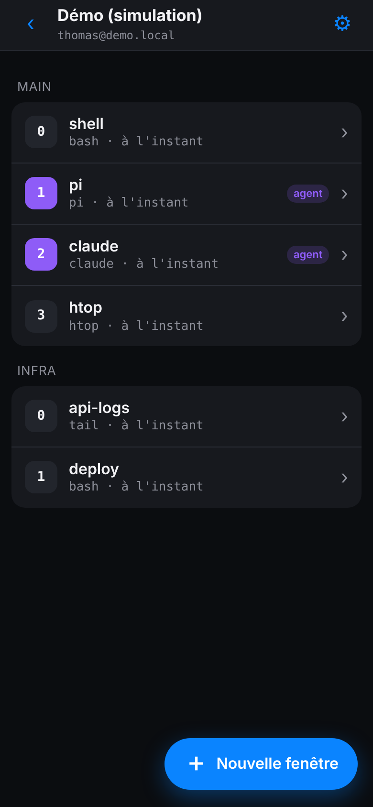
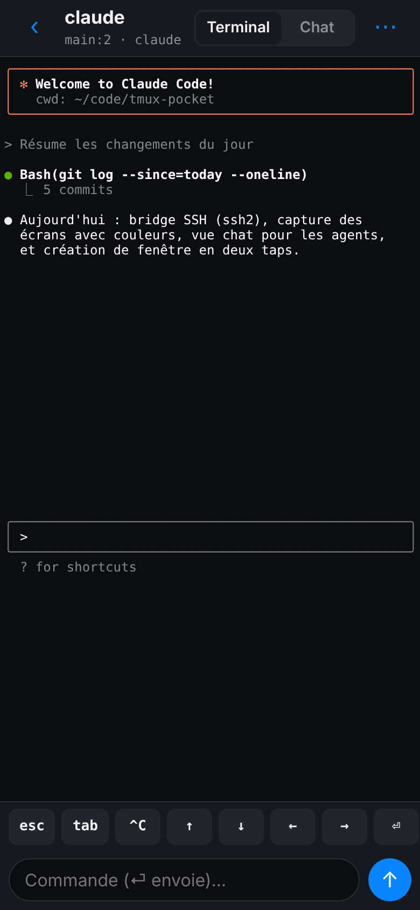
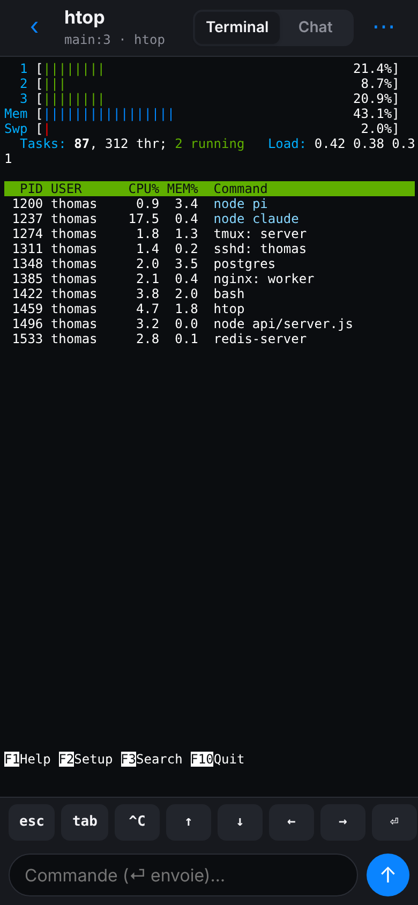

# tmux-pocket

**Your agents, in your pocket, from tmux and your infra.**

An iPhone-first manager for remote **tmux** sessions, with a **native chat view** for terminal coding agents
(pi, claude, codex, aider, gemini, opencode…). You save an SSH server once, see every tmux window, and start a new agent in two taps.

> 🚧 **Building in public.** This is an early prototype and the repo shows how it's built, commit by commit.


## Demo

<table>
<tr>
<td width="34%"></td>
<td>

**Two taps to start an agent:** tap ＋ New window, then **pi**.
The window is created on the server, the command starts and the window opens.

**Chat with the agent:** the agent's TUI is cleaned up into chat bubbles.
Your message is typed into the real tmux window, so the agent itself doesn't change.

**Terminal view:** a pixel-exact render of the pane, colours included, with a key bar
for `esc`, `tab`, `^C` and the arrows.

The demo runs entirely in the browser with a built-in simulator. No server needed.

</td>
</tr>
</table>

| Your tmux windows | New window in 2 taps | Agent chat | Terminal | Any TUI |
|:-:|:-:|:-:|:-:|:-:|
|  |  |  |  |  |

## How it works

```
iPhone (web app / PWA) ──HTTP JSON──▶ bridge (Node + ssh2) ──SSH──▶ your server
                                                                     tmux list-windows -a
                                                                     tmux capture-pane -p -e
                                                                     tmux send-keys -l
                                                                     tmux new-window / resize-window / kill-window
```

It's plain tmux on your server. The app adds no daemon or agent wrapper there.

- **Window list**: `tmux ls`, one row per window, grouped by session and refreshed every 3 s. Agent windows get a badge.
- **Terminal**: the app polls `capture-pane -e` and renders it with [xterm.js](https://xtermjs.org). It never attaches as a tmux client, so your desktop client keeps its size.
- **Fit to iPhone**: the app resizes the window to about 50 columns so TUIs reflow for the phone. It restores automatic sizing when you leave the window.
- **Chat**: the app strips borders, the input box and hard wraps from the TUI, then shows the rest as bubbles. Your message is sent with `send-keys`.
- **New window**: the command runs inside a shell, so the window survives when the agent exits.

Under the hood: a single `web/index.html` file with no build step, and a bridge of about 200 lines that depends only on [ssh2](https://github.com/mscdex/ssh2).

## Try it

**Demo only:** open `web/index.html` in a browser. On a desktop it shows inside a phone frame.

**With your own server:**

```bash
cd bridge
npm install
npm start                     # http://127.0.0.1:8022
```

Open that URL and add a server: host, port, user, default session, start directory and quick commands
(or paste a `~/.ssh/config` block). The app shows the bridge's **public key**: add it once to `~/.ssh/authorized_keys`
on that server, and you're connected. No private key is ever pasted into the app.

### Self-host on your own domain (use it from your iPhone)

The bridge runs on one of your servers, behind HTTPS on your domain. It serves the app and opens the SSH connections
to your other servers (plain IPv4 or hostnames). Its API refuses plain HTTP from anywhere but the machine itself.

The install guides are written to be **checked by you, then run by your coding agent**. They list everything they touch
and what they never do, with a verify step and stop conditions after every command:

- [`deploy/INSTALL-SERVER.md`](deploy/INSTALL-SERVER.md): your agent runs **on the server** (self-contained, give it as is).
- [`deploy/INSTALL-FROM-COMPUTER.md`](deploy/INSTALL-FROM-COMPUTER.md): your agent runs **on your computer** and deploys over SSH.

Your agent never gets general root: it may only run one audited script, [`deploy/tmux-pocket-install`](deploy/tmux-pocket-install),
through a single sudo rule. Every file it writes as root is embedded in that script, and its arguments are validated.

1. Read [What this install touches](deploy/INSTALL-SERVER.md#what-this-install-touches) and
   [Privileges](deploy/INSTALL-SERVER.md#privileges-what-the-agent-can-do-as-root).
2. Do the [human setup](deploy/INSTALL-SERVER.md#human-setup-once) on the server (2 minutes): install the installer
   root-owned, add its sudo rule, and point a DNS A record (for example `pocket.your-domain.tld`) to the server.
3. Give this to an agent running on that server (for an agent on your computer, use the prompt in the other guide):

```text
Install tmux-pocket on this server by following deploy/INSTALL-SERVER.md from
https://github.com/tsua0002/tmux-pocket at commit <REF>, section "Steps for the agent", exactly.
DOMAIN=pocket.your-domain.tld
REF=<REF>
You may only use sudo as: sudo -n /usr/local/sbin/tmux-pocket-install <command>.
Stop and ask me whenever the guide says STOP. Never show me or log BRIDGE_TOKEN or the private key.
```

4. Read the token yourself on the server (`sudo grep BRIDGE_TOKEN /etc/tmux-pocket.env`), open `https://pocket.your-domain.tld`
   on your iPhone, log in, then *Share → Add to Home Screen*.
5. For each server, run the one-line command shown in the app: it adds the bridge's public key to `authorized_keys`.

## Security: where the secrets live

| Secret | Where it lives | Never |
|---|---|---|
| SSH private key | Generated by the bridge on first start in `STATE_DIR` (`/var/lib/tmux-pocket`, dir `0700`, file `0600`) | Sent over the network, shown in the app, stored on the phone, committed |
| Your servers' host keys | Pinned on first connection in `STATE_DIR/known_hosts.json`; a changed key is refused | Silently accepted |
| `BRIDGE_TOKEN` | `/etc/tmux-pocket.env` (`0600`) on the bridge host | Stored on the phone: login opens an `HttpOnly`, `Secure`, `SameSite=Strict` session cookie that JavaScript can't read |
| SSH password (optional) | Phone memory while the app is open | Saved anywhere |

- The phone's storage only holds addresses and preferences. Secrets saved by older versions are purged on load.
- Everything travels over HTTPS (HSTS on), and the API refuses plain HTTP from anywhere but the machine itself.
- The bridge only answers same-origin JSON requests (no CORS) and refuses to listen on a public address without `BRIDGE_TOKEN`.
- On your servers the key is installed with `restrict`: no port, agent or X11 forwarding, no terminal, only commands.
- `.gitignore` blocks `*.env`, keys and `known_hosts*`, and the bridge keeps its state outside the repo.
- Installing needs one sudo rule for one audited script, never general root. The service then runs as an unprivileged,
  sandboxed user.
- To revoke access, remove the `tmux-pocket@…` line from a server's `authorized_keys`, or rotate the key by deleting `STATE_DIR/id_ed25519`.
- Prefer keeping the bridge behind a VPN (WireGuard, Tailscale) in addition to HTTPS.

Bridge tests run against a real tmux: `cd bridge && npm test`.

## Roadmap

- [x] Saved SSH servers, tmux window list, terminal view, key bar
- [x] Agent chat view and new window in two taps
- [x] In-browser simulator for working on TUI rendering
- [ ] Chat renderers tuned per agent (pi, claude, codex…)
- [ ] Native iOS app: [Capacitor](https://capacitorjs.com) around `web/`, plus a Swift SSH plugin
      ([Citadel](https://github.com/orlandos-nl/Citadel)) to replace the bridge, with credentials in the iOS Keychain
- [ ] Native app: SSH key generated in the iPhone's Secure Enclave (never exportable), no bridge needed
- [ ] Optional Tailscale SSH (no key to manage at all)
- [ ] ProxyJump, push notifications when an agent waits for input

Everything goes through one function, `api(srv, op, args)`, with the ops `list`, `capture`, `send`, `keys`, `new`, `kill` and `resize`.
Swapping the transport doesn't touch the UI.

## License

[MIT](LICENSE)
